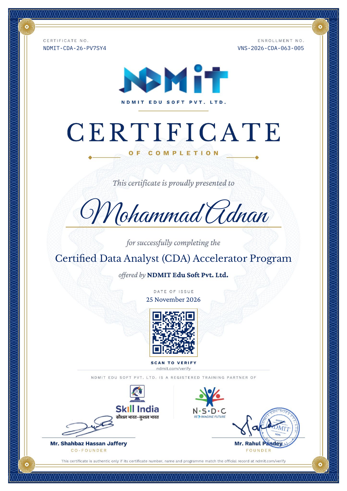

# Read_me
About Me
👋 Hi, I'm Mohammad Adnan
MSc Botany → Data Analytics → Data Science 📊

I'm an MSc Botany graduate from MGKVP, Varanasi, transitioning into the world of Data Analytics and Data Science.

My background in science taught me to think analytically, ask questions, work with evidence, and understand complex systems. I'm now applying that mindset to data — turning raw information into meaningful insights, interactive dashboards, and data-driven solutions.

I'm currently focused on strengthening my skills in Python, SQL, Excel, Power BI, Data Visualization, Machine Learning, and Generative AI.

🚀 About Me
🎓 MSc Botany graduate from Mahatma Gandhi Kashi Vidyapith (MGKVP)
📍 Based in Varanasi, Uttar Pradesh, India
📊 Building my career in Data Analytics & Data Science
🐍 Learning and working with Python
🗄️ Working with SQL & PostgreSQL
📈 Creating interactive dashboards using Power BI & DAX
📑 Using Excel for data analysis and reporting
🤖 Exploring Machine Learning & Generative AI
💡 Passionate about solving real-world problems using data
🌱 Continuously learning, building, and improving
🛠️ Tech Stack
💻 Programming & Data Analysis

🗄️ Database & SQL

📊 Analytics & Visualization

🧠 Currently Exploring

## 🏆 Certifications

### Certified Data Analyst (CDA) Accelerator Program — NDMIT, Nov 2026
- **Certificate No.:** NDMIT-CDA-26-PV7SY4
- **Issued:** 25 November 2026
- **Verify:** https://ndmit.com/verify/?cert=NDMIT-CDA-26-PV7SY4

📊 What I Like Working On

I enjoy projects that involve:

🔍 Exploratory Data Analysis
🧹 Data Cleaning & Transformation
🗄️ SQL Analysis & Business Queries
📈 Power BI Dashboards
📊 Data Visualization
💼 Business & Customer Analytics
🌾 Agriculture & Scientific Data
🤖 Machine Learning & AI

My goal is not just to create charts, but to answer:

"What does the data tell us, and what should we do about it?"

⭐ Featured Projects
🛒 E-Commerce Sales Analytics

Tools: SQL • PostgreSQL • Power BI • DAX

An end-to-end analytics project focused on sales performance, customer behavior, product performance, profitability, and business trends.

Key areas:

Sales & profit analysis
Customer segmentation
Product performance
Monthly & yearly trends
KPI dashboards
Business recommendations
🌾 Agriculture Data Analytics

Tools: PostgreSQL • Python • Power BI • Excel

An analytics project combining my scientific background with data analytics to explore agricultural production, crop trends, prices, regions, and seasonal patterns.

Key areas:

Crop production analysis
Regional comparison
Price trends
Seasonal patterns
Interactive Power BI dashboards
🦠 COVID-19 Impact Analysis

Tools: Python • SQL • Power BI

An exploratory project analyzing the impact of COVID-19 using historical datasets to understand trends, changes over time, geographical differences, and major patterns in the data.

🍎 Business Intelligence Dashboard

Tools: Power BI • DAX • Excel

Interactive business dashboards designed to transform raw data into easy-to-understand KPIs, trends, comparisons, and actionable insights.

📚 Currently Learning
Python
 ├── NumPy
 ├── Pandas
 ├── Data Cleaning
 └── Exploratory Data Analysis

SQL
 ├── Joins
 ├── Subqueries
 ├── CTEs
 ├── Window Functions
 └── Business Analysis

Power BI
 ├── Data Modeling
 ├── DAX
 ├── Time Intelligence
 └── Dashboard Design

🎯 My Career Goal

Data Science
 ├── Statistics
 ├── Machine Learning
 ├── Model Evaluation
 └── Generative AI
 
I'm working toward becoming a Data Analyst / Data Scientist who can combine technical skills with analytical thinking to solve real-world problems.

My long-term goal is to build solutions that connect:

Data → Insights → Decisions → Impact

🤝 Let's Connect

I'm always interested in learning, collaborating on projects, and connecting with people working in Data Analytics, Data Science, AI, and Business Intelligence.

🔗 LinkedIn: Connect with me on LinkedIn

📂 GitHub: github.com/mohammad-adnan-ds

🌱 A Little About My Journey

"My degree taught me how to understand life through science.
Now I'm learning how to understand the world through data."

⭐ Thanks for visiting my profile!
